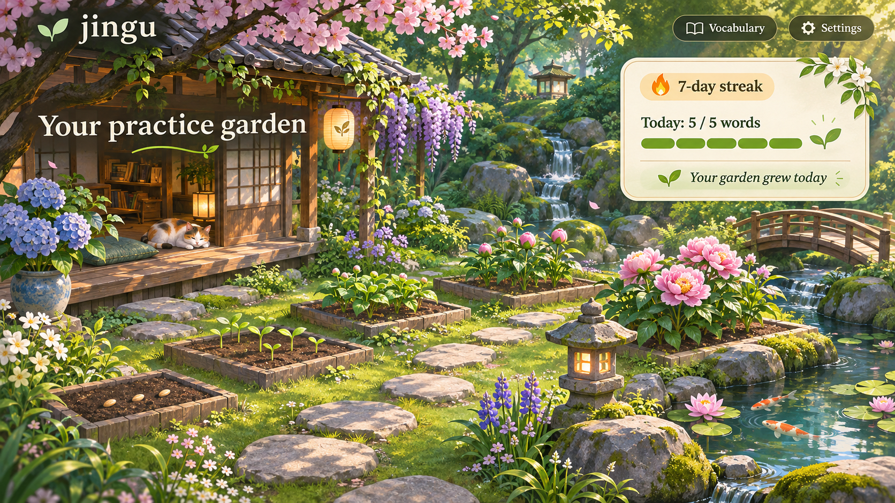

# Garden visual concept

This is an illustrative art-direction mockup, not a screenshot of a working dashboard. The seven-day streak and five-word progress are sample data. Final UI will use accessible HTML for controls and numbers and reusable art assets for deterministic growth.

Generated with the built-in image generation tool. Final prompt:

> Use case: ui-mockup. Preview-only visual concept for Jingu, a daily language practice dashboard. Create a beautiful polished cozy-game-style website mockup dominated by a lush isometric garden, painterly detailed game illustration, soft sunlight, rich green foliage, delicate flowering plants, stepping stones and small planting beds showing seeds, sprouts, buds and blooms. The garden should feel rewarding and alive, refined rather than childish. Wide desktop composition with a large immersive garden and restrained readable UI. Exact UI text: "jingu", "Your practice garden", "7-day streak", "Today: 5 / 5 words", "Your garden grew today", "Vocabulary", "Settings". Use clean elegant typography and a small tasteful progress panel. Treat numbers as illustrative concept data. No device frame, no watermarks. This is a visual direction mockup, not a functional application.
