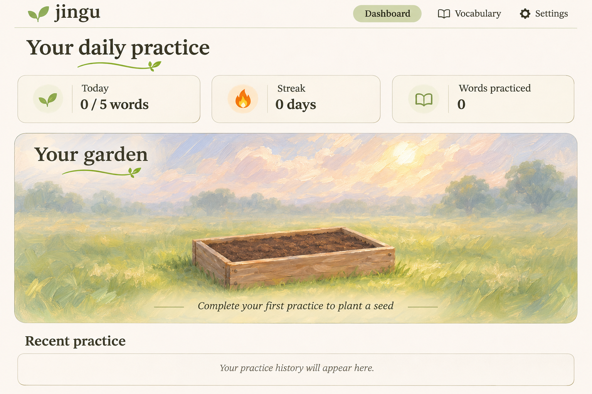

# Garden visual concept

Current direction: open directly to the dashboard, with daily progress, streak, words practiced, and recent activity. The garden is a contained illustration: one empty wooden garden box against a simple, dreamy oil-painted landscape. The box starts with bare soil and no plants. This is an illustrative mockup, not a working dashboard; zero counts are sample new-user data. Final UI will use accessible HTML for controls and numbers and reusable art assets for deterministic growth. Plant a seed after completing the daily goal; the mockup caption's “first practice” means completing that goal.

The previous [lush garden concept](assets/garden-concept.png) is retained for reference but superseded by this simpler direction.

## Revision 2 prompt

Generated with the built-in image generation tool, editing the previous concept.

> Edit the supplied Jingu dashboard concept into a much simpler dashboard-first design. Preserve its dreamy atmosphere but replace the elaborate scene with a soft oil-painted illustrative landscape with visible brushwork, hazy meadow, distant muted trees and a luminous sky. Exactly ONE modest wooden rectangular garden box containing only bare dark soil: NO plants, seeds, sprouts or flowers inside it. No other garden boxes anywhere. Remove buildings, cats, ponds, bridges, lanterns, dense flowers and ornate decoration. This is the new learner's empty garden. Make the site mostly a clear useful dashboard rather than a full-screen game environment: a clean header "jingu" with "Dashboard", "Vocabulary", "Settings"; heading "Your daily practice"; three concise stat cards reading "Today" / "0 / 5 words", "Streak" / "0 days", "Words practiced" / "0". Below them place a large contained garden illustration panel titled "Your garden", with the single empty box centered in the oil-painted scene. A subtle caption reads "Complete your first practice to plant a seed". Include a small "Recent practice" area reading "Your practice history will appear here." Prioritize spacious layout, readable elegant typography, restrained calm colors, minimal UI, and dreamlike oil painting for the illustration. Wide desktop website mockup, no device frame, no marketing hero or landing page, no watermark. All numbers are illustrative new-user states.

## Original prompt

Generated with the built-in image generation tool. Final prompt:

> Use case: ui-mockup. Preview-only visual concept for Jingu, a daily language practice dashboard. Create a beautiful polished cozy-game-style website mockup dominated by a lush isometric garden, painterly detailed game illustration, soft sunlight, rich green foliage, delicate flowering plants, stepping stones and small planting beds showing seeds, sprouts, buds and blooms. The garden should feel rewarding and alive, refined rather than childish. Wide desktop composition with a large immersive garden and restrained readable UI. Exact UI text: "jingu", "Your practice garden", "7-day streak", "Today: 5 / 5 words", "Your garden grew today", "Vocabulary", "Settings". Use clean elegant typography and a small tasteful progress panel. Treat numbers as illustrative concept data. No device frame, no watermarks. This is a visual direction mockup, not a functional application.
