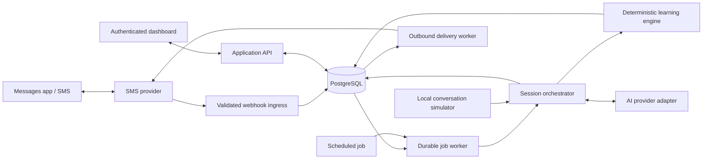

# Jingu system design

Status: proposed implementation design. Confirmed scope and provisional defaults are recorded in [decisions.md](decisions.md).

## Product experience

Jingu is a text-first conversation partner with an explicit memory of the learner's vocabulary. The learner can discuss a topic naturally, ask for explanations, and switch between conversation and review without navigating a flashcard interface.

A typical session:

1. The learner texts “practice” or replies to an opted-in reminder.
2. The session planner selects overdue senses first, then due senses, then a bounded number of new senses. Selection is deterministic, with due time and stable ID as tie-breakers.
3. AI builds a short scenario using those learning objectives. It may ask the learner to order food, describe a day, or make plans.
4. Each learner message receives a conversational response, with brief corrections when useful. Jingu records word exposure and usage separately from recall.
5. Jingu occasionally asks a targeted recall question without revealing the answer. Eligible responses produce one recorded assessment for the review opportunity.
6. The learner can say “done” at any time. Jingu summarizes progress, the daily goal, and the next due workload.

Commands include practice, done, hint, progress, pause reminders, and language selection. Provider opt-out commands are processed before AI. “Done” ends a learning session; STOP opts out of messaging. Ordinary conversational intent can be classified by AI, but permission changes and state transitions pass through explicit application handlers.

## Architecture

Keep the first deployment a modular monolith with an API process and a worker process. Avoid separate microservices. PostgreSQL-backed jobs and an outbox are sufficient initially; add a separate queue only when measured load justifies it.

The learning engine is a pure module. It accepts explicit state, timestamps, and validated events, and returns the next state. It does not call AI, the database, the system clock, or a messaging service.

## AI boundary

AI owns scenario generation, explanations, conversational replies, and proposed semantic assessments. It receives a bounded conversation window, learner settings, and selected vocabulary IDs. It cannot directly update a schedule, create arbitrary vocabulary records, set a streak, or send a message.

An assessment proposal includes an opportunity ID, vocabulary sense ID, exact evidence span from the learner message, outcome, hint use, and a concise explanation. Application code validates:

- The opportunity belongs to this learner and session and remains open.
- The sense is part of the planned opportunity.
- The cited evidence exists in the learner message.
- The output conforms to its schema and allowed outcomes.
- The same opportunity has not already been assessed.

Ambiguous or invalid proposals produce clarification rather than advancement. Model-reported confidence alone is not evidence of correctness. For tightly scoped recall checks, accepted answers can be evaluated with deterministic language-pack rules. For open conversation, semantic correctness remains probabilistic even when the resulting scheduler is deterministic.

Persist accepted assessments and model/prompt versions. Replay saved assessments; do not rerun AI to rebuild history. A temperature setting is not a determinism guarantee. If an assessment is corrected, append a correction event and recompute affected state from the event history.

## Vocabulary and Korean support

Vocabulary is a structured library, not an unbounded list extracted by AI. Each item represents a particular sense and may be a word or a multiword expression. Separate recognition and production review cards; v1 conversation focuses on production.

Each entry includes:

- Stable sense ID, BCP-47 language tag, lemma or canonical expression, part of speech, gloss, level, and topic tags.
- Examples, accepted variants, optional pronunciation/romanization, and provenance or license.
- For Korean: Hangul canonical forms, reviewed inflections, politeness/register notes, and optional segmentation hints.

Store Unicode NFC text. Do not treat Korean as English-style whitespace tokens or count arbitrary substrings as vocabulary matches. For example, 먹다 and 먹어요 may refer to the same underlying verb sense, while similarly spelled words may not. Use curated variants for constrained checks; semantic assessment handles broader contexts subject to validation. Do not strip distinctions that change meaning.

New languages supply language packs and evaluation hooks. The scheduler only sees IDs, ratings, timestamps, and policy versions. No Korean-specific branching belongs in the scheduling engine. First Korean alpha pack: approximately 50 reviewed everyday senses, written for the project or sourced with explicit reuse rights.

## Practice events and counts

Expose separate counts per sense:

| Metric | Definition | Advances SRS? |
| --- | --- | --- |
| Exposures | Distinct delivered tutor messages containing the sense | No |
| Learner uses | Distinct learner messages with validated usage of the sense | No by itself |
| Recall attempts | Assessed eligible review opportunities, including failures | Yes, according to outcome |
| Successful recalls | Eligible opportunities rated hard, good, or easy | Yes |

Count a sense at most once per message for usage/exposure, even if repeated several times. Count an opportunity at most once. Keep unsupported matches pending or omit them rather than presenting them as verified practice. A tutor message containing the answer does not establish independent recall. A copied or hinted answer cannot receive an unassisted rating.

Casual use of a not-yet-due word adds usage history without repeatedly pushing its due date out. A follow-up retry within the same opportunity is teaching activity, not another graded review.

## Deterministic scheduler v1

Use a transparent interval ladder, versioned as `ladder-v1`: 1, 3, 7, 14, 30, 60, 120, 240 days. This is a pragmatic initial policy, not a claim of optimal retention. A later FSRS implementation can replace it through an explicit versioned migration after sufficient review history exists.

Card state: stage (initially -1), dueAt, lastReviewedAt, successfulReviews, lapses, reviewCount, and policyVersion. Explicit server-received UTC timestamps are inputs. Scheduling days mean 24-hour durations; calendar-day goals and streaks use local dates separately.

| Accepted rating | State transition | Next due time |
| --- | --- | --- |
| Again | Set stage to -1; increment lapses | Review timestamp + 10 minutes |
| Hard | Set stage to max(0, current stage) | Review timestamp + interval at resulting stage |
| Good | Advance one stage, capped at final stage | Review timestamp + interval at resulting stage |
| Easy | Advance two stages, capped at final stage | Review timestamp + interval at resulting stage |

All accepted ratings increment reviewCount; all except Again increment successfulReviews. Correct but hinted responses are mapped to Again for independent-recall scheduling, with a distinct pedagogical explanation and stored hint flag. Incorrect answers map to Again. Semantically correct unaided answers default to Good. Hard/Easy require an explicit learner difficulty signal attached to the opportunity; typing speed is not used to infer difficulty. New cards are immediately eligible; a failed review can become due again after ten minutes through a new opportunity. Earlier teaching repetitions do not reschedule it.

Within one database transaction, lock the card, insert the uniquely keyed accepted assessment, update card state, and update relevant progress projections. Reject stale or out-of-order assessment transitions instead of silently applying them. Serialize learner turns to preserve conversational and review order.

Scheduler tests cover exact transitions, stage caps, failures, hints, duplicate event replay, out-of-order events, and deterministic selection. Storage-level uniqueness and transaction tests cover concurrent deliveries; a pure scheduler alone cannot provide exactly-once effects.

## Streaks and daily progress

Proposed daily goal: eligible recall attempts for five distinct senses across any learning languages. Incorrect attempts count toward effort; passive exposure and repeated attempts on the same sense do not increase the daily distinct-sense goal. Successful recall remains visible separately.

Store a qualifying local date when the goal is reached, using the learner's configured IANA timezone. Persist event-time local date and timezone; do not relabel past practice after a timezone change. Apply timezone changes to the next daily period to avoid duplicate qualification.

Current streak is the consecutive run of qualifying dates ending today, or ending yesterday if today is still incomplete. If neither today nor yesterday qualifies, current streak is zero. Longest streak is the longest consecutive run in stored qualifying dates. Compare calendar dates, not elapsed 24-hour chunks, to handle daylight saving time.

Display “today complete” separately from current streak. No freeze or grace-day system in v1. Do not reset a streak because an SMS delivery failed; qualification derives from accepted practice events.

## Data model

| Entity | Important fields and constraints |
| --- | --- |
| users | ID, timezone, instruction language, goal, reminder settings |
| learning_profiles | User + target language unique; level, active pack, topic preferences |
| channel_accounts | User, provider, encrypted address, lookup hash, verification and consent state |
| vocab_senses | ID, language, canonical form, gloss, examples, level, source |
| vocab_variants | Sense ID, accepted form, normalization/register metadata |
| review_cards | User + sense + skill unique; scheduler state and version |
| sessions | User, target language, scenario, status, started/ended timestamps |
| messages | Provider + external ID unique for inbound; direction, session, body, timestamps, delivery status |
| review_opportunities | User, card, session, prompt message, hint state, expected card version, status |
| assessments | Opportunity ID unique, evidence, rating, evaluator version, timestamp |
| practice_events | User, sense, message, event type; unique deduplication key |
| daily_progress | User + local date unique; qualification and goal snapshot |
| jobs / outbox | Unique operation key, payload, status, attempts, lease, next attempt |

Use foreign keys and ownership checks. Derived counts can initially be queried from events; add materialized projections only when needed. Preserve assessment/event history for replay, with a defined account deletion path. Raw conversations should have a configurable retention policy; durable learning events need not retain entire messages indefinitely.

## Message processing and reminders

Inbound processing:

1. Validate the provider signature with its official SDK and the canonical public webhook URL.
2. Persist the message and job atomically, deduplicated by provider message ID; acknowledge quickly after durable acceptance.
3. Process opt-outs and known commands before AI. Unknown phone numbers receive only the defined onboarding flow and cannot access an existing learner's data.
4. Acquire per-learner processing ownership. Load state, select pending opportunities, and make a bounded AI call with timeout and retry policy.
5. Validate output, commit learning events and outbound intent atomically, then let the delivery worker send.
6. Track delivery status callbacks separately. Delivery failures do not undo a valid learner assessment.

An outbox avoids losing outbound intent, but it does not guarantee exactly-once SMS delivery after an ambiguous provider timeout. Store provider IDs when known; reconcile ambiguous sends before retrying where possible, and surface unresolved delivery status. Never claim exactly-once external delivery unless the provider supports the required idempotency contract.

One scheduled scan creates reminder jobs for opted-in learners within their configured local window. Unique user/date/reminder-kind keys prevent duplicate reminders. Recheck consent and completion immediately before sending; skip completed days, respect quiet hours, and do not send catch-up reminders after the window. STOP must disable queued reminders as well as future scheduling. Provider-generated opt-out confirmations should not receive duplicate application confirmations.

## Dashboard

The dashboard supports the texting habit. Initial views:

- Today: distinct senses practiced versus goal, due count, and next reminder.
- Streak: current, longest, and today-complete state.
- Activity: local-date calendar and practice totals by language.
- Vocabulary: searchable senses with exposures, uses, recall attempts, successful recalls, and next due time.
- Sense detail: review history and rating explanations.
- Settings: active language, timezone, reminder time, and pause state.

Use authenticated server queries, scoped to the signed-in learner. Link a verified messaging address during onboarding. Do not authenticate dashboard access using a phone number in a query parameter. Use real empty states and clearly labeled simulator data during development.

Proposed API surface: `GET /api/progress`, `GET /api/vocabulary`, `GET /api/vocabulary/:id`, `PATCH /api/settings`, `POST /webhooks/sms/inbound`, and `POST /webhooks/sms/status`. Simulator endpoints are development-only. Dashboard mutation routes require session authentication and CSRF protection where applicable.

## Deployment and operational controls

Deploy the API, worker, and database in one region initially. Serve the dashboard through a web host or the API deployment. Choose the hosting provider during implementation; the Sites workflow is an option for the dashboard but does not itself settle backend hosting.

Keep credentials server-side and out of Git. Redact phone numbers and raw message bodies from ordinary logs. Track processing delay, failed jobs, AI schema failures, review acceptance rate, duplicate webhooks, message delivery failures, and estimated per-session AI/SMS usage. Cap reply length, model calls per session, and daily messaging. Korean SMS may use more segments than an equivalent short Latin-script message, so validate segment costs against the selected provider before release.

If AI is unavailable, offer a curated recall prompt or a brief retry response without inventing a grade. Failed jobs retain retry state; repeated failure goes to an inspectable dead-letter state. Test backup restoration and event replay before relying on the app for daily progress.

## Integration references

These sources inform the adapter design; they do not imply integrations have been provisioned.

- [Twilio incoming message webhook](https://www.twilio.com/docs/messaging/guides/webhook-request): inbound request format and official signature validation guidance.
- [Twilio messaging webhooks](https://www.twilio.com/docs/usage/webhooks/messaging-webhooks): inbound and delivery-status integration.
- [Twilio Advanced Opt-Out](https://www.twilio.com/docs/messaging/tutorials/advanced-opt-out): provider opt-out state and confirmations.
- [Apple Messages framework](https://developer.apple.com/documentation/messages): iMessage application/extension framework, a different integration surface from the proposed SMS backend.
- [Apple Messages for Business](https://support.apple.com/en-us/102053): business conversation experience; not selected for v1.
