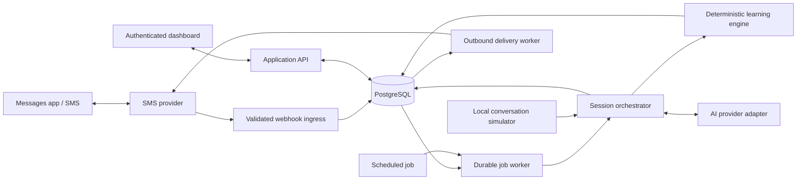

# Jingu system design

Status: proposed implementation design. Confirmed scope and provisional defaults are recorded in [decisions.md](decisions.md).

## Product experience

Jingu is a text-first conversation partner with an explicit memory of the learner's vocabulary. The learner can discuss a topic naturally, ask for explanations, and switch between conversation and review without navigating a flashcard interface.

A typical session:

1. The learner texts “practice” or replies to an opted-in reminder.
2. The deterministic session planner selects specific review cards using due state, the configured session size, and translation direction. It persists the ordered plan before any AI call.
3. AI receives the current selected word sense and direction and builds a conversational question around that objective. It may ask the learner to order food, describe a day, or make plans, but cannot select or replace the tested word.
4. Each learner message receives a conversational response, with brief corrections when useful. Jingu records word exposure and usage separately from recall.
5. Jingu occasionally asks a targeted recall question without revealing the answer. Eligible responses produce one recorded assessment for the review opportunity.
6. The learner can say “done” at any time. Jingu summarizes progress, the daily goal, and the next due workload.

Commands include practice, done, hint, progress, pause reminders, and language selection. Provider opt-out commands are processed before AI. “Done” ends a learning session; STOP opts out of messaging. Commands and settings use explicit application handlers, not a separate AI intent-classification call. AI calls are limited to conversational testing, explanations, and grading.

## Architecture

Keep the first deployment a modular monolith with an API process and a worker process. Avoid separate microservices. PostgreSQL-backed jobs and an outbox are sufficient initially; add a separate queue only when measured load justifies it.

The SRS engine should be its own package (`packages/learning`), not its own deployed service for v1. The worker invokes it directly, and the application persists its output in the same transaction as the accepted assessment. The worker is a separate process to handle slow AI and messaging operations; that does not require a separate SRS service or network hop. Consider extracting a service only if multiple independent applications need scheduling or independent scaling/ownership becomes necessary.

The learning engine is a pure module. It accepts explicit state, timestamps, and validated events, and returns the next state. It does not call AI, the database, the system clock, or a messaging service.

## AI boundary

V1 calls a third-party hosted model API from Jingu's backend through `packages/ai`. Jingu manages the provider account, server-side API credentials, and usage billing. Learners authenticate only with Jingu for dashboard access and link their verified phone number for SMS; they do not sign in to the model provider or supply their own API keys. No model is self-hosted in v1.

Keep provider credentials in deployment secrets, never in browser code, SMS, or Git. Send only the selected vocabulary, grading settings, and bounded practice context needed for the turn; omit phone numbers and account identifiers from model inputs. Practice text is processed by the third-party provider, which should be explained during onboarding. Select the initial provider/model using a Korean grading evaluation set, latency, and cost, and review its data-handling settings before activation. The adapter allows a future provider change without changing SRS logic.

AI owns conversational testing of the selected word, explanations, conversational replies, and proposed semantic assessments. It receives a bounded conversation window, the active word sense and reference examples, translation direction, and a snapshot of grading settings. It cannot select the next word, reorder the queue, expand session size, update settings, directly update a schedule, create arbitrary vocabulary records, set a streak, or send a message. Reminders, progress summaries, queue selection, and daily-goal calculations use application code and templates.

The turn sequence is: deterministic planner selects card → AI asks a question about that card → learner answers → AI proposes a semantic grade → application validates and maps the result to a rating → SRS computes the next due time → application advances to the next planned card. Grading and next-card prompt generation are logically separate; a follow-up generation call can only use a next card already selected by application code. No separate AI extraction pass is used to mine incidental words from conversation; optional usage observations can accompany an existing grading response and must pass validation.

An assessment proposal includes an opportunity ID, vocabulary sense ID, direction, exact evidence span from the learner message, semantic outcome (`correct`, `incorrect`, or `uncertain`), answer form (`native_script`, `transliteration`, or `mixed`), spelling/meaning notes, and a concise explanation. Hint state comes from the application's opportunity record, not a model assertion. Application code validates:

- The opportunity belongs to this learner and session and remains open.
- The sense is part of the planned opportunity.
- The direction and grading-policy version match the opportunity snapshot.
- The cited evidence exists in the learner message.
- The output conforms to its schema and allowed outcomes.
- The same opportunity has not already been assessed.

Ambiguous or invalid proposals produce clarification rather than advancement. Model-reported confidence alone is not evidence of correctness. AI grades meaning in context rather than requiring exact-string equality, using the curated sense and examples as reference. It can accept minor misspellings, valid inflections, equivalent English meanings, and alternate romanizations when the grading policy allows them. A spelling difference that changes the intended sense must not automatically pass. Semantic grading remains probabilistic even though selection and schedule transitions are deterministic; schema validation cannot prove that a semantic judgment is correct.

Persist accepted assessments and model/prompt versions. Replay saved assessments; do not rerun AI to rebuild history. A temperature setting is not a determinism guarantee. If an assessment is corrected, append a correction event and recompute affected state from the event history.

## Vocabulary and Korean support

Vocabulary is a structured library, not an unbounded list extracted by AI. Each item represents a particular sense and may be a word or a multiword expression. Maintain separate review cards for English → Korean (production) and Korean → English (recognition), generalized to source and target language IDs. Both directions are available in v1; success in one never advances the other.

Each entry includes:

- Stable sense ID, BCP-47 language tag, lemma or canonical expression, part of speech, gloss, level, and topic tags.
- Examples, accepted variants, optional pronunciation/romanization, and provenance or license.
- For Korean: Hangul canonical forms, reviewed inflections, politeness/register notes, and optional segmentation hints.

Store Unicode NFC text. Do not treat Korean as English-style whitespace tokens or count arbitrary substrings as vocabulary matches. For example, 먹다 and 먹어요 may refer to the same underlying verb sense, while similarly spelled words may not. Curated variants inform AI grading rather than acting as an exhaustive exact-match whitelist. Do not strip distinctions that change meaning.

New languages supply language packs and evaluation hooks. The scheduler only sees IDs, ratings, timestamps, and policy versions. No Korean-specific branching belongs in the scheduling engine. First Korean alpha pack: approximately 50 reviewed everyday senses, written for the project or sourced with explicit reuse rights.

## Practice events and counts

Expose separate counts per sense:

| Metric | Definition | Advances SRS? |
| --- | --- | --- |
| Exposures | Distinct delivered tutor messages containing the sense | No |
| Learner uses | Distinct learner messages with validated usage of the sense | No by itself |
| Recall attempts | Assessed eligible review opportunities, including failures | Yes, according to outcome |
| Successful recalls | Eligible opportunities rated hard, good, or easy | Yes |

Count a sense at most once per message for usage/exposure, even if repeated several times. Count an opportunity at most once. Keep unsupported matches pending or omit them rather than presenting them as verified practice. A tutor message containing the answer does not establish independent recall. A copied or hinted answer cannot receive an unassisted rating.

Casual use of a not-yet-due word adds usage history without repeatedly pushing its due date out. A follow-up retry within the same opportunity is teaching activity, not another graded review.

## Deterministic scheduler v1

Word selection and interval updates both belong to this engine. Given the same card state, settings snapshot, explicit time, and accepted history, it returns the same ordered plan and next due times without AI.

For a single-direction session, filter to that direction, select due cards ordered by dueAt then stable card ID, and fill remaining slots with new senses in pack order subject to the daily new-sense limit. Overdue cards naturally sort first. Never silently fill with not-yet-due cards. If eligible material is insufficient, return a shorter plan and explain why. Optional extra practice does not reschedule not-yet-due cards.

For mixed mode, build the two eligible queues and alternate directions, starting with the direction whose earliest due card is oldest (production first on a tie or when both have only new cards). Skip a sense already selected in the session so the reverse prompt cannot immediately reveal its answer. If a queue is exhausted, fill from the other. Preserve due-before-new priority globally: alternate across due queues first, then across new queues. This is a deterministic best-effort mix, not a guaranteed 50/50 ratio. A new sense consumes the daily introduction allowance once across directions; introducing its reverse card later does not consume a second allowance.

Use a transparent interval ladder, versioned as `ladder-v1`: 1, 3, 7, 14, 30, 60, 120, 240 days. This is a pragmatic initial policy, not a claim of optimal retention. A later FSRS implementation can replace it through an explicit versioned migration after sufficient review history exists.

Card state: stage (initially -1), dueAt, lastReviewedAt, successfulReviews, lapses, reviewCount, and policyVersion. Explicit server-received UTC timestamps are inputs. Scheduling days mean 24-hour durations; calendar-day goals and streaks use local dates separately.

| Accepted rating | State transition | Next due time |
| --- | --- | --- |
| Again | Set stage to -1; increment lapses | Review timestamp + 10 minutes |
| Hard | Set stage to max(0, current stage) | Review timestamp + interval at resulting stage |
| Good | Advance one stage, capped at final stage | Review timestamp + interval at resulting stage |
| Easy | Advance two stages, capped at final stage | Review timestamp + interval at resulting stage |

All accepted ratings increment reviewCount; all except Again increment successfulReviews. Correct but hinted responses are mapped to Again for independent-recall scheduling, with a distinct pedagogical explanation and stored hint flag. Incorrect answers map to Again. Semantically correct unaided answers default to Good. Hard/Easy require an explicit learner difficulty signal attached to the opportunity; typing speed is not used to infer difficulty. New cards are immediately eligible; a failed review can become due again after ten minutes through a new opportunity. Earlier teaching repetitions do not reschedule it.

Within one database transaction, lock the card, insert the uniquely keyed accepted assessment, update card state, and update relevant progress projections. Reject stale or out-of-order assessment transitions instead of silently applying them. Serialize learner turns to preserve conversational and review order.

Scheduler tests cover exact transitions, stage caps, failures, hints, duplicate event replay, out-of-order events, and deterministic selection. Storage-level uniqueness and transaction tests cover concurrent deliveries; a pure scheduler alone cannot provide exactly-once effects.

## Practice settings

Store preferences per learner and language pair; instruction language is a separate setting. The dashboard exposes these controls, with explicit SMS commands such as `settings`, `words 10`, `direction mixed`, and `transliteration on` using the same validated settings API.

| Setting | Allowed values | Proposed initial default |
| --- | --- | --- |
| `wordsPerSession` | Integer 1–50 | 5 distinct word senses |
| `directionMode` | `source_to_target`, `target_to_source`, `mixed` | English → Korean |
| `allowTransliteration` | Boolean | true |

Session size counts distinct senses, not messages or follow-up attempts. The daily streak goal remains a separate setting; two sessions can contribute toward the same daily goal. A mixed session tests each selected sense in only one direction.

When transliteration is allowed, a recognizable romanization can receive the same semantic credit as native script, even when it differs from a canonical romanization. When disabled, a Korean answer written only in romanization cannot pass; Jingu asks for Hangul. Store such a response as a format mismatch without accepting a review grade or advancing the schedule; a later conforming answer is graded within the same opportunity. Mixed-script responses are judged on the target-word evidence, not Latin characters elsewhere in the message. Hangul spelling mistakes still receive semantic grading. In Korean → English mode, English answers are expected and are not rejected as Korean transliteration; Korean prompts use Hangul in either setting.

The opportunity snapshots the language pack's Unicode target-script identifier. When transliteration is disabled for production, validate that the cited target-word evidence contains the expected script, even if the model labels it `mixed` or `native_script`. This catches romanized-only evidence mislabeled by the model; presence of native script alone is not proof of semantic correctness, which still requires grading. `answerForm` describes the target-word evidence, not the whole message.

Snapshot session size and direction when creating the plan, and snapshot grading policy for each opportunity. Default-setting changes apply to the next session, so an in-flight answer is never judged under a silently changed rule. Record answer form and policy version on assessments so the dashboard can distinguish romanized from Hangul recalls. Changing transliteration preference does not erase history or reset the schedule; strict Hangul-only mastery is not inferred from earlier romanized success.

## Streaks and daily progress

Proposed daily goal: eligible recall attempts for five distinct senses across any learning languages. Incorrect attempts count toward effort; passive exposure and repeated attempts on the same sense do not increase the daily distinct-sense goal. Successful recall remains visible separately.

Store a qualifying local date when the goal is reached, using the learner's configured IANA timezone. Persist event-time local date and timezone; do not relabel past practice after a timezone change. Apply timezone changes to the next daily period to avoid duplicate qualification.

Include a one-day streak hold: at least one eligible distinct-sense recall attempt can bridge a partial-practice day without increasing the streak count. Proposed policy: holds activate automatically and cannot be used on consecutive days. A full-goal day restores hold eligibility. There are no banked holds, retroactive holds, or zero-practice holds.

| Local-day result | Effect |
| --- | --- |
| Full goal reached | Add one to the active streak, or start a new streak at one if the previous chain broke |
| At least one eligible sense attempted, below goal, yesterday was a completed day in an active streak | Preserve the count for this day; record a hold |
| Partial practice after a held day | No second hold; completing the full goal before day-end is required to preserve the chain |
| No eligible practice by day-end | Break the chain |

A hold cannot start or revive a streak. Correctness is not required: an accepted incorrect recall attempt qualifies as practice just as it does for the daily goal. Passive exposure, ungraded chat, format-only clarifications, and duplicate events do not qualify. If the daily goal is one word, one eligible word completes it normally; there is no partial-practice range for that goal.

Compute the streak by walking local dates in order. Completed days increment the count, held days preserve it, and missed days reset it. The longest streak is the maximum completed-day count within a chain bridged only by valid single-day holds; held days never increase current or longest counts. Compare calendar dates, not elapsed 24-hour chunks, to handle daylight saving time.

During an unfinished current day, retain the chain through yesterday and show what is needed today. After a held day, display “Complete today's goal to keep your streak”; do not reset it until the local day ends unsuccessfully. A partial day that is eligible for a hold can still become complete later that day: replace its held status with complete and increment the count exactly once. Day-end finalization must be idempotent; reads derive the correct state even if the scheduled finalization job is delayed. Use persisted server receipt times for day attribution, so delayed grading of an on-time message can recompute that day's result without permitting a newly sent message to backfill yesterday.

Example with a five-word goal: Monday completes the goal → streak 1; Tuesday practices one word → streak still 1, held; Wednesday completes the goal → streak 2. If Wednesday instead ends with only one word, the streak breaks; Thursday completing the goal starts at 1.

Display distinct calendar states for complete, held, partial, and missed days, plus an in-progress state for today with no practice yet. SMS recaps for held days say “Streak held at 7. Complete your goal tomorrow to keep it going,” rather than claiming an eighth completed day. Show hold eligibility and today's remaining requirement on the dashboard. Holds affect streak continuity only: they do not advance vocabulary schedules, mark the daily goal complete, or defer overdue cards. Do not reset a streak because an SMS delivery failed; qualification derives from accepted practice events.

## Data model

| Entity | Important fields and constraints |
| --- | --- |
| users | ID, timezone, instruction language, goal, reminder settings |
| learning_profiles | User + source/target language pair unique; level, active pack, topics, wordsPerSession, directionMode, allowTransliteration, settings version |
| channel_accounts | User, provider, encrypted address, lookup hash, verification and consent state |
| vocab_senses | ID, language, canonical form, gloss, examples, level, source |
| vocab_variants | Sense ID, accepted form, normalization/register metadata |
| review_cards | User + sense + source/target pair + direction unique; scheduler state and version |
| sessions | User, language pair, ordered selected card IDs, settings snapshot, scenario, status, started/ended timestamps |
| messages | Provider + external ID unique for inbound; direction, session, body, timestamps, delivery status |
| review_opportunities | User, card, session, prompt message, grading-policy snapshot, hint state, expected card version, status |
| assessments | Opportunity ID unique, evidence, semantic outcome, answer form, direction, accepted rating, evaluator/policy versions, timestamp |
| practice_events | User, sense, message, event type; unique deduplication key |
| daily_progress | User + local date unique; distinct eligible senses, goal/timezone snapshot, complete/held/partial/missed status, completion time, streak-policy version; derivable from practice events |
| jobs / outbox | Unique operation key, payload, status, attempts, lease, next attempt |

Use foreign keys and ownership checks. Derived counts can initially be queried from events; add materialized projections only when needed. Preserve assessment/event history for replay, with a defined account deletion path. Raw conversations should have a configurable retention policy; durable learning events need not retain entire messages indefinitely.

## Message processing and reminders

Inbound processing:

1. Validate the provider signature with its official SDK and the canonical public webhook URL.
2. Persist the message and job atomically, deduplicated by provider message ID; acknowledge quickly after durable acceptance.
3. Process opt-outs and known commands before AI. Unknown phone numbers receive only the defined onboarding flow and cannot access an existing learner's data.
4. Acquire per-learner processing ownership. Load state, select pending opportunities, and make a bounded AI call with timeout and retry policy.
5. Validate output, commit learning events and outbound intent atomically, then let the delivery worker send.
6. Track delivery status callbacks separately. Delivery failures do not undo a valid learner assessment.

An outbox avoids losing outbound intent, but it does not guarantee exactly-once SMS delivery after an ambiguous provider timeout. Store provider IDs when known; reconcile ambiguous sends before retrying where possible, and surface unresolved delivery status. Never claim exactly-once external delivery unless the provider supports the required idempotency contract.

One scheduled scan creates reminder jobs for opted-in learners within their configured local window. Unique user/date/reminder-kind keys prevent duplicate reminders. Recheck consent and completion immediately before sending; skip completed days, respect quiet hours, and do not send catch-up reminders after the window. STOP must disable queued reminders as well as future scheduling. Provider-generated opt-out confirmations should not receive duplicate application confirmations.

## Dashboard

The dashboard supports the texting habit, with a beautiful game-style garden as its centerpiece. Proposed visual direction: a lush, softly lit isometric garden with painterly game art, flowering plants, stepping stones, and gentle ambient motion. The garden occupies the main view; compact progress controls and vocabulary details remain readable beside or below it. This is an art direction to review, not a finished UI.

### Garden rewards

- Completing the daily goal awards exactly one permanent growth step for that learner/local date, even across multiple sessions or languages. Show a small growth animation when completion is first observed; progress updates whether practice happened over SMS or in the simulator.
- Proposed progression: each five growth steps develops one planting through seed, sprout, leaves, bud, and bloom. Then start the next planting. Use stable ordered planting slots and unlock additional beds as needed, so growth continues beyond the first week. The first completed day visibly adds a planted seed rather than requiring five days for feedback.
- A one-word streak hold gives a gentle watering effect and a held-day label, but no growth step or additional streak count. Partial practice ineligible for a hold shows ordinary daily progress without a hold reward.
- Missing a day pauses growth. Existing plants remain: resetting the streak does not erase the garden earned through past practice. Garden size represents total completed days, while the streak represents the current practice chain.
- Multiple visits, webhook retries, or repeated completions of the same day never award extra growth. A held day upgraded to complete later earns one step. Recompute from canonical daily results after corrections rather than accumulating irreversible client-side rewards.

Render the garden deterministically from completed-day records and a versioned progression/art mapping. Use pre-created illustrated assets and lightweight CSS/canvas animation; do not make runtime AI/image-generation calls to grow the garden. Store a per-user last-seen reward marker only for animation delivery, not as the source of earned progress. The dashboard API supplies completion count, growth stage/planting slots, current daily state, and hold eligibility, scoped to the authenticated learner.

Keep progress labels as accessible HTML, support reduced motion with a static growth state, and provide a text equivalent such as “12 completed practice days · 2 blooming plants · 1 sprout.” Garden interactions are optional for practicing: no watering chore or click is needed to claim a reward. On mobile, preserve the garden focal point and put essential progress immediately below it.

### Progress views

Initial views:

- Garden: cumulative completed-day growth, today's practice progress, and an explicit complete/held/in-progress label.
- Today: distinct senses practiced versus goal, due count, and next reminder.
- Streak: current, longest, today-complete/held state, hold eligibility, and the practice required to preserve the chain; held dates are visibly different from completed dates.
- Activity: local-date calendar and practice totals by language.
- Vocabulary: searchable senses with exposures, uses, recall attempts, successful recalls, and next due time.
- Sense detail: review history and rating explanations.
- Settings: active language pair, words per session, translation direction (including mixed), transliteration policy, daily goal, timezone, reminder time, and pause state.
- Direction-specific review history and answer-form labels, so romanized recall is not presented as demonstrated Hangul production.

Use authenticated server queries, scoped to the signed-in learner. Link a verified messaging address during onboarding. Do not authenticate dashboard access using a phone number in a query parameter. Use real empty states and clearly labeled simulator data during development.

Proposed API surface: `GET /api/progress`, `GET /api/vocabulary`, `GET /api/vocabulary/:id`, `PATCH /api/settings`, `POST /webhooks/sms/inbound`, and `POST /webhooks/sms/status`. Simulator endpoints are development-only. Dashboard mutation routes require session authentication and CSRF protection where applicable.

## Deployment and operational controls

Deploy the API, worker, and database in one region initially. Serve the dashboard through a web host or the API deployment. Choose the hosting provider during implementation; the Sites workflow is an option for the dashboard but does not itself settle backend hosting.

Keep credentials server-side and out of Git. Redact phone numbers and raw message bodies from ordinary logs. Track processing delay, failed jobs, AI schema failures, review acceptance rate, duplicate webhooks, message delivery failures, and estimated per-session AI/SMS usage. Cap reply length, model calls per session, and daily messaging. Korean SMS may use more segments than an equivalent short Latin-script message, so validate segment costs against the selected provider before release.

If AI is unavailable, offer a curated recall prompt or a brief retry response without inventing a grade. Failed jobs retain retry state; repeated failure goes to an inspectable dead-letter state. Test backup restoration and event replay before relying on the app for daily progress.

## Integration references

These sources inform the adapter design; they do not imply integrations have been provisioned.

- [Twilio incoming message webhook](https://www.twilio.com/docs/messaging/guides/webhook-request): inbound request format and official signature validation guidance.
- [Twilio messaging webhooks](https://www.twilio.com/docs/usage/webhooks/messaging-webhooks): inbound and delivery-status integration.
- [Twilio Advanced Opt-Out](https://www.twilio.com/docs/messaging/tutorials/advanced-opt-out): provider opt-out state and confirmations.
- [Apple Messages framework](https://developer.apple.com/documentation/messages): iMessage application/extension framework, a different integration surface from the proposed SMS backend.
- [Apple Messages for Business](https://support.apple.com/en-us/102053): business conversation experience; not selected for v1.
